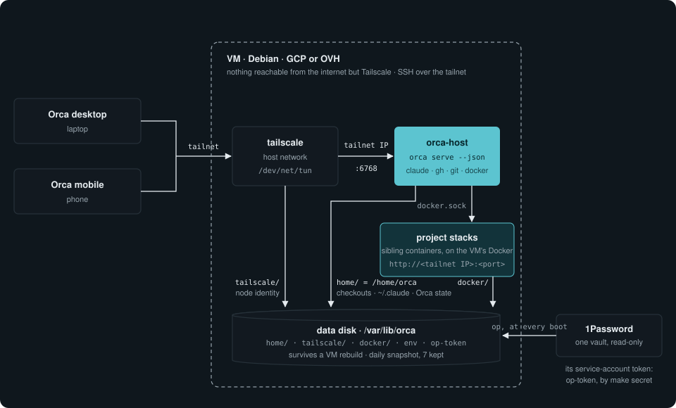
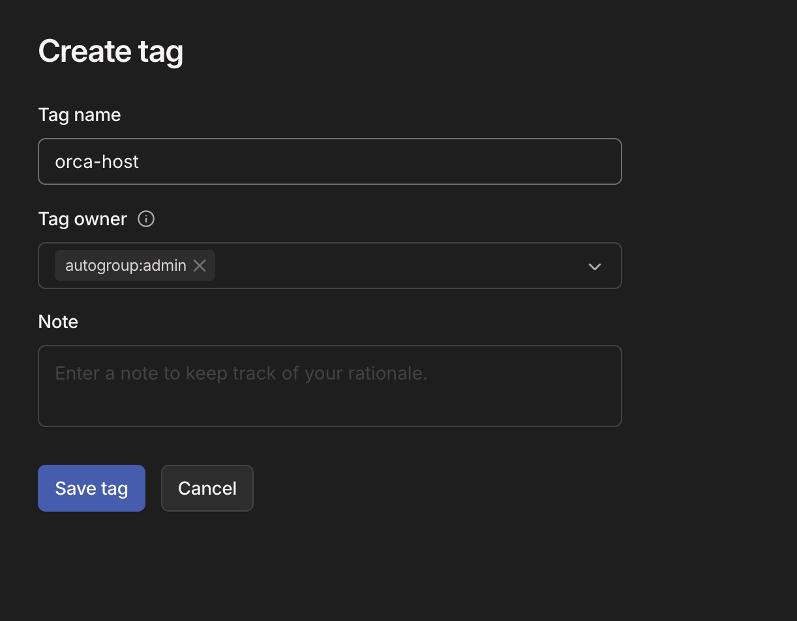
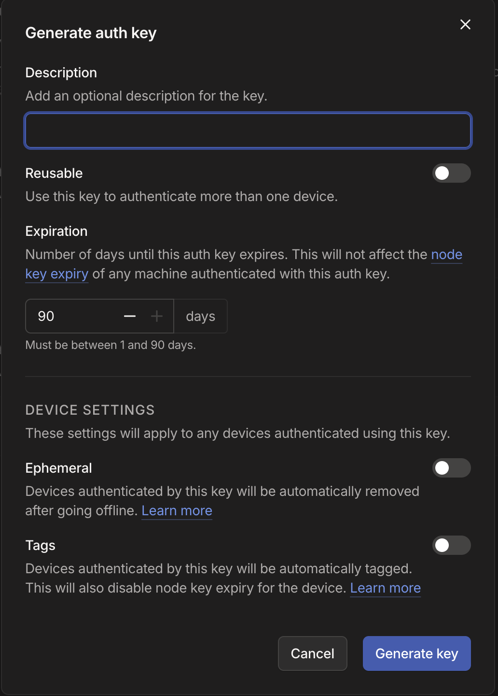
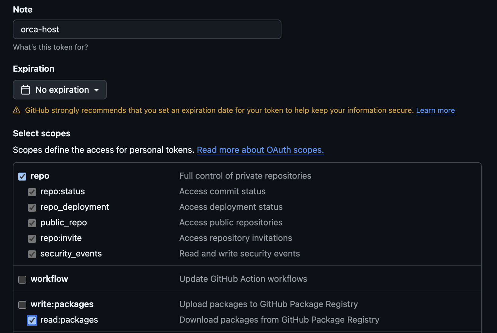
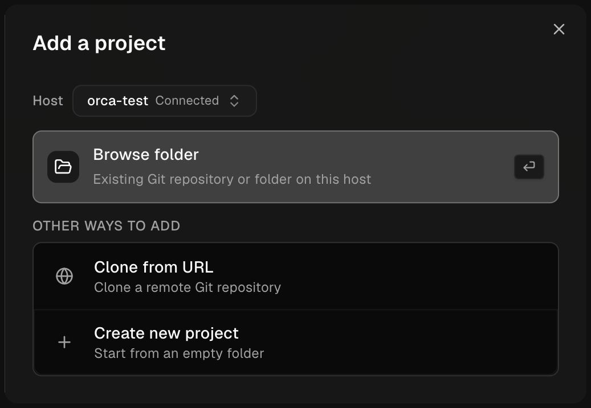
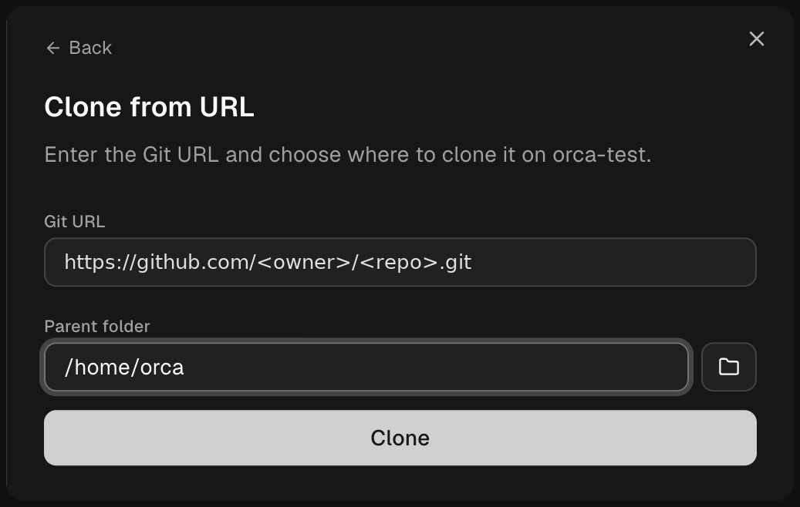

# orca-host

A headless [Orca](https://github.com/stablyai/orca) server on a GCP VM, used from the desktop and mobile Orca clients over the tailnet. One host per person, all of their projects on it. How it works and why: [`.claude/knowledge/`](.claude/knowledge/).



## What is configured where

| What | Where |
|---|---|
| The host: name, GCP project, zone, 1Password vault, SSH key | `terraform.tfvars` |
| Your tokens, git identity, Claude preferences, any variable your tools read | `.env.tpl` |
| The secret values `.env.tpl` points at | 1Password, the vault `op_vault` names |
| Your Claude permissions, `CLAUDE.md`, skills, MCP servers | a git repository of yours, optional |
| Your own binaries and MCP servers | an image of yours, `FROM` this one, optional |
| What a project needs | that project's repository |

Neither file holds a secret: in `.env.tpl` a secret is a reference, `{{ op://Vault/Item/field }}`, resolved by the host. Keep both in a repository of yours, or here, gitignored; `TFVARS` and `ENV_TPL` tell `make` where they are (default `terraform/$PROVIDER/terraform.tfvars`, i.e. `terraform/gcp/terraform.tfvars`, and `.env.tpl`). Secrets in other 1Password accounts: [Several 1Password accounts](#several-1password-accounts).

## Install

Needed on the laptop: `docker`, `terraform`, `gcloud`, `op` (1Password CLI), `jq`, `ssh`, `qrencode`, the Orca desktop CLI.

1. **Once per tailnet**: a tag `orca-host`, owner `autogroup:admin`, in the Tailscale admin console → Access controls → Tags.

   

2. **Once per GCP project**: `gcloud auth application-default login`, then `make bootstrap`.
3. **A 1Password vault for the host**: the tokens your agents use, no passwords. A service account on it, read-only; its token in an item `orca-host-op-token` of that vault, one for all your hosts.
4. **`terraform/gcp/terraform.tfvars`**: `terraform/gcp/terraform.tfvars.example`, filled in.
5. **`.env.tpl`**, one `VAR=value` per line, each secret an item in that vault:

   ```sh
   # Tailscale → Settings → Keys: not reusable, not ephemeral, tag orca-host. Used once: a new host, a new key
   TS_AUTHKEY={{ op://Vault/tailscale/authkey }}
   # `claude setup-token`
   CLAUDE_CODE_OAUTH_TOKEN={{ op://Vault/claude/token }}
   # a classic token (fine-grained ones do not work), scopes repo + read:org
   GH_TOKEN={{ op://Vault/github/token }}
   GIT_AUTHOR_NAME=...
   GIT_AUTHOR_EMAIL=...
   # optional, see Claude settings
   CLAUDE_PERMISSION_MODE=auto
   CLAUDE_SETTINGS_REPO=me/claude
   # anything else reaches every session as is: the ${FOO_TOKEN} of an MCP server, what your tools read
   FOO_TOKEN={{ op://Vault/foo/token }}
   ```

    

6. **The host**:

   ```bash
   make init      # once per checkout
   make apply     # VPC, data disk, a Debian VM made into the host at its first boot
   make secret    # the service-account token, over SSH (IAP until the host is on the tailnet)
   make pair      # the desktop client, then the phone (Tailscale on, same tailnet)
   ```

   Then, in the desktop app: Settings → Remote Orca Servers → Advanced → Active Server.

## On an OVH VPS

The same host on an OVH VPS, Debian underneath. `PROVIDER=ovh` on every `make` (or exported); Terraform and the OVH CLI run from an image, so `terraform` is not needed. The state is in a GCS bucket all the same (`make bootstrap` above), read with application-default credentials, or else gcloud's active account. Steps 1, 3 and 5 above apply; the host's `name` is its own, not another host's: it names the state, the tailnet node and the token item.

1. **The VPS**: `make apply` orders one (`plan_code`, `datacenter`), paid with the account's default payment method; or one already ordered, its `service_name` in the tfvars. An additional disk keeps `/var/lib/orca` across reinstalls.
2. **OVH API credentials** ([createtoken](https://eu.api.ovh.com/createToken/?GET=/vps/*&POST=/vps/*&PUT=/vps/*&POST=/order/cart*&GET=/me/payment/method&GET=/me/order*&POST=/me/order*), these rights filled in: `GET/POST/PUT /vps/*`, and to order `POST /order/cart*`, `GET/POST /me/order*`, `GET /me/payment/method`) as an item `ovh-api` of the vault: fields `endpoint` (`ovh-eu`), `application_key`, `application_secret`, `consumer_key`.
3. **`terraform/ovh/terraform.tfvars`**: `terraform/ovh/terraform.tfvars.example`, filled in. `.env.tpl` as above.
4. **The host**:

   ```bash
   export PROVIDER=ovh
   make init      # once per checkout
   make apply     # orders or imports the VPS, reinstalls it: Debian, Docker, the stack
   make secret    # the service-account token, over SSH: the public address the first time
   make pair
   make lockdown  # SSH on the tailnet only
   ```

`make apply` reinstalls the VPS: what is on it goes.

## Projects

In the app: Add a project → Clone from URL, the https URL, parent folder `/home/orca`.

 

A project brings itself up from its worktree setup hook: `docker compose`, `.env` files — `op inject -i .env.tpl -o .env` works as is, against the host's vault; against another account's, `OP_SERVICE_ACCOUNT_TOKEN="$OP_SERVICE_ACCOUNT_TOKEN_<NAME>" op inject …`. What it starts is at `http://<tailnet IP>:<port>`. A deleted worktree is cleaned up within 5 minutes: its stack, volumes and the images compose built included. The build cache is capped at 10 GB.

## Claude settings

Two optional lines in `.env.tpl`:

- `CLAUDE_PERMISSION_MODE`: `default`, `acceptEdits`, `auto` or `plan`.
- `CLAUDE_SETTINGS_REPO`: `<owner>/<repo>`; its `permissions`, `CLAUDE.md`, `.claude/skills/` and `config/mcp.json` are applied at every start. With `auto`, `op` needs an allow rule there. Details: [claude-settings.md](.claude/knowledge/claude-settings.md).

## Several 1Password accounts

A service account reads one vault of one account. For each other account, a service account on its vault, read-only, and a second template next to `.env.tpl`:

```sh
# .env.tpl: the token, an item of the host's vault
OP_SERVICE_ACCOUNT_TOKEN_ACME={{ op://Vault/acme-op-token/credential }}

# .env.acme.tpl: resolved with that token
ACME_API_TOKEN={{ op://Acme Vault/api/credential }}
```

The host resolves `.env.tpl`, then each `.env.<name>.tpl` with `OP_SERVICE_ACCOUNT_TOKEN_<NAME>`; every variable reaches the sessions resolved. A file that does not resolve keeps the host down, as `.env.tpl` does. Each token is in every session too, so each of those vaults is technical and read-only as well.

## Your own tools

An image of yours, built by your CI, public:

```dockerfile
FROM ghcr.io/qrafttech/orca-host:main@sha256:<digest>
RUN curl -fsSL -o /tmp/x "<url>" && echo "<sha256>  /tmp/x" | sha256sum -c - \
 && install -m 755 /tmp/x /usr/local/bin/<tool> && rm /tmp/x
# optional: your templates travel with the image; the laptop's, if any, win over them
COPY .env.tpl /etc/orca-host/env.tpl
COPY .env.acme.tpl /etc/orca-host/env.acme.tpl
```

Then `orca_image = "ghcr.io/me/orca-host:main"` in `terraform.tfvars`, and `make rebuild`, once. To keep the `FROM` up to date, `.github/dependabot.yml` in that repository:

```yaml
version: 2
updates:
  - package-ecosystem: docker
    directory: /
    schedule: { interval: daily }
```

## When you change something

| You changed | You do |
|---|---|
| this repository, merged to `main` | nothing if the host runs the base image; else merge Dependabot's pull request in yours |
| your own image, merged to its `main`, its templates included | nothing: the host redeploys within five minutes |
| a token in 1Password, the laptop's templates, your settings repository | `make restart` |
| `orca_image`, `compose.yaml`, `host/` | `make rebuild` |
| `zone`, to the other of `data_disk_zones` (the VM's zone is out of stock, or down) | `make apply` |
| nothing, but the service-account token expired | a new token in its item, `make secret`, `make restart` |

All of them end live terminals and keep the data disk: checkouts, pairing, Docker images and volumes. To stay on one build, name its `sha-<sha>` tag in `orca_image`.

## Day to day

```bash
make restart   # take changes now; ends live terminals
make logs
make shell     # a shell in the container, as an Orca terminal sees it
make ssh       # a shell on the VM
```

The data disk fills with live worktrees: `docker system df` from `make shell` says what takes it, `docker system prune` gives back an image built by hand.

## Develop

Every push builds the image, tagged `<branch>` and `sha-<sha>`. On a Mac: `make build`, then `make up` runs it with Docker Desktop on the laptop's tailnet IP.
